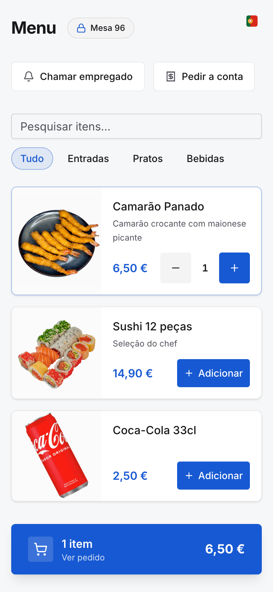
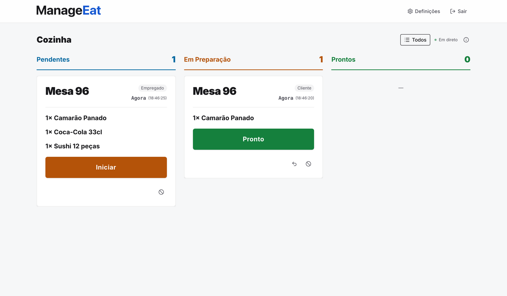
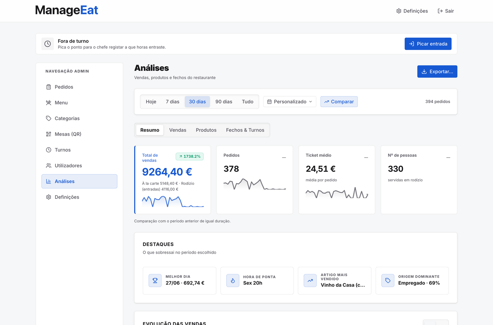

# Manage Eat

[](https://github.com/filipeiglesias17/ManageEat/actions/workflows/ci.yml)

POS open-source para restaurantes (à la carte **e** rodízio): pedidos à mesa por QR
code, ecrã de cozinha, gestão de empregados, fecho de conta/turnos e análises de
vendas. Pensado para correr **na própria máquina do restaurante** (localhost/LAN) —
não há nuvem nem servidor de app à parte.

<p align="center">
  
  
</p>
<p align="center">
  
</p>

> **Beta (v0.1).** A app é funcional mas continua em evolução. Lê a nota de segurança
> e as limitações conhecidas abaixo antes de a usar a sério.

## Stack

React 19 + TypeScript + Vite + Tailwind CSS v4, com **Supabase local** (Postgres +
Auth + Realtime) em Docker. O browser fala diretamente com o Supabase: a fronteira
de segurança são as **políticas RLS + triggers** em [`supabase/migrations/`](supabase/migrations),
testadas por [`supabase/audit.ts`](supabase/audit.ts).

## Pré-requisitos

- **Node.js ≥ 22** e npm (o cliente Supabase precisa do WebSocket nativo do Node)
- **Docker Desktop** instalado ([docker.com](https://www.docker.com/products/docker-desktop/)) —
  o Supabase local arranca em contentores; o launcher tenta abri-lo sozinho
- **mkcert** para os certificados HTTPS da LAN (o launcher diz-te como instalar se faltar)
- macOS testado a fundo; Windows e Linux suportados pelo launcher mas **por validar**
  em máquina real (o backup agendado é macOS-only)

## Arranque rápido (launcher)

Um único comando prepara a máquina na primeira vez (npm install, certificados,
`.env.local`) e, no dia-a-dia, arranca tudo com verificações de saúde. Corre-o
logo a seguir ao clone — basta o Node; se o Docker ou o mkcert faltarem, o
launcher pára e diz exatamente como os instalar:

```bash
node scripts/launcher/manage-eat.mjs start   # equivalente: npm run launcher:start
```

> **A primeira vez demora.** O arranque inicial instala as dependências e descarrega
> as imagens Docker do Supabase (~2–3 GB) — conta com vários minutos, mesmo que
> pareça parado. Nos dias seguintes o arranque é rápido.

No fim aparece o endereço para os telemóveis/tablets (IP da máquina, porta 5173).
Deixa a janela aberta. Fechá-la (ou Ctrl+C) pára o frontend e o proxy — a base de
dados **continua a correr**; para parar tudo (e garantir o snapshot a frio no
arranque da manhã seguinte) usa o `launcher:stop`. Mais comandos:

```bash
npm run launcher:stop                 # para TUDO (frontend, proxy e base de dados)
npm run launcher:stop -- --keep-db    # para o frontend/proxy mas deixa a base de dados
npm run launcher:status               # o que está a correr, IP atual e último snapshot
npm run launcher:shortcuts            # cria "ManageEat" e "Parar ManageEat" no Ambiente de Trabalho
npm run launcher:autostart            # arrancar sozinho ao ligar a máquina (:off para desligar)
```

Na primeira vez, com a base de dados vazia, o launcher **pergunta** se queres criar
as contas e o menu de exemplo (seed) — nunca o faz sozinho.

### Primeira instalação num restaurante real

Um restaurante novo **não precisa do seed**. Ao abrir a app pela primeira vez (sem
nenhum administrador criado), aparece o ecrã **"Configurar o restaurante"**: escolhe
o utilizador e a password do administrador e ficas logo dentro do painel de admin.
A partir daí crias o teu menu, as tuas contas e as definições. A password muda-se
depois em **"A minha conta"** (no canto da barra de topo). O `npm run seed` é só para
**demonstração/desenvolvimento** (traz 5 contas e um menu fictícios) e está protegido:
recusa correr se a base de dados já tiver dados reais.

### Por baixo do capô (arranque manual)

O launcher só compõe os comandos que já existem — podes sempre corrê-los à mão:

```bash
npm install                 # instala dependências
npm run setup:https         # gera certs/ com mkcert (1ª vez: brew install mkcert nss)
npm run db:start            # arranca o Supabase local + aplica migrações (snapshot antes)
npm run db:status           # mostra as URLs e chaves locais (anon + service_role)
# copia .env.example para .env.local e preenche com os valores de db:status:
#   VITE_SUPABASE_URL, VITE_SUPABASE_ANON_KEY, SUPABASE_SERVICE_ROLE_KEY
npm run seed                # SÓ AGORA (precisa do .env.local): 5 contas de exemplo + menu
npm run dev                 # frontend em http://localhost:5173 (exposto na LAN com --host)
npm run tls:proxy           # noutra janela: proxy HTTPS do staff (deixa a correr)
```

## HTTPS / desenvolvimento na LAN (opcional, recomendado em produção)

O tráfego do **staff** (login, pagamentos) pode viajar **encriptado** na WiFi sem partir o fluxo dos
**clientes** que pedem pelo QR. O modelo é híbrido: o front-end e o Supabase ficam em **http** (o
cliente liga direto), e os aparelhos do staff falam **https** com o Supabase através de um mini-proxy
TLS. Os certificados são locais, gerados com [`mkcert`](https://github.com/FiloSottile/mkcert):

```bash
brew install mkcert nss   # 1ª vez (o nss é p/ o Firefox confiar)
npm run setup:https       # gera certs/ (localhost + 127.0.0.1 + IP da LAN) e corre mkcert -install
npm run tls:proxy         # mini-proxy TLS do staff (https → Supabase); deixa a correr
```

Só os aparelhos do **staff** precisam de **confiar na CA uma vez** (instalar `certs/rootCA.pem`); os
telemóveis dos **clientes** não precisam de nada. Os passos por dispositivo (iOS/Android/desktop)
são impressos no fim do `npm run setup:https`. A pasta `certs/` está no
`.gitignore` — a chave privada **nunca** vai para o git.

## ⚠️ Regra nº1 — nunca perder dados

A app corre em localhost **mesmo em produção** (máquina on-premise de cada
restaurante) → **a BD Docker local é a produção**. Os dados reais vivem aí.

- **Aplicar migrações:** `npm run db:migrate` (ou `npm run db:start`, que migra
  sozinho). **NUNCA** uses `npm run db:reset` para migrar — `db:reset` apaga tudo
  (está protegido e pede confirmação).
- **Recuperar:** `npm run db:backups` (lista) → `npm run db:restore <nome>`. Há
  snapshots automáticos pré-arranque/pré-reset e um diário (launchd, macOS).

## Validação (gate)

```bash
npm run gate         # dia-a-dia: eslint + tsc + testes (0 erros)
npm run gate:release # gate + vite build (antes de entregas / ota:publish)
npm run gate:rules   # auditoria RLS: corre supabase/audit.ts (precisa do Supabase local + seed)
```

Quando o diff toca a RLS (`supabase/migrations/`, `src/lib/db*`, `supabase/audit.ts`),
correr `gate:rules` é obrigatório. Regra do projeto: cada mudança de RLS = pelo
menos 1 teste `ok` e 1 `deny`.

## Nota de segurança

O login e a autorização de staff usam Supabase Auth + **políticas RLS** baseadas no
`profiles` (id = `auth.users.id`). Como o browser fala direto com o Supabase, a
segurança real são a RLS + triggers em `supabase/migrations/`. A service_role
**nunca** vai para o browser — só em scripts de terminal (ver `.env.example`).

## Limitações conhecidas (beta)

As funcionalidades abaixo estão assinaladas com o selo **Beta** na app (a lista
vive em `src/lib/beta-features.ts` e aparece nas Definições do admin):

- **Export SAF-T (PT).** XML experimental para estudo — sem assinatura/Hash,
  ATCUD nem validação XSD. Não serve para entrega à AT.
- **Notificações só com a app aberta.** Os alertas do empregado (chamada de mesa,
  pedido pronto, pedido atrasado) tocam som + vibração + notificação do sistema
  **enquanto a app está aberta** (mesmo noutro ecrã do telemóvel). Com a app fechada
  ou o telemóvel bloqueado/suspenso **não há alerta** — não há *push* (APNs/FCM), o
  tempo-real do Supabase suspende quando o sistema congela a app. É uma limitação
  arquitetural assumida: mantém a app aberta no aparelho de serviço.
- **Escritas offline falham.** Sem ligação, criar um pedido/chamada falha (com aviso
  claro) até a rede voltar — não há fila offline.
- **Gestão de utilizadores.** "Remover" desativa a conta (reativável); apagar
  por completo a conta de autenticação ainda não é possível a partir do browser
  (a service_role nunca sai dos scripts de terminal). Mudar a password de outra
  conta **já é possível** — via um RPC `SECURITY DEFINER` que valida `is_admin()`,
  sem expor a service_role.
- **Windows/Linux por validar.** O launcher cobre as três plataformas, mas só o
  macOS foi testado a fundo; o backup diário automático é, por agora, só macOS.
- **OTA e HTTPS do staff.** Funcionais, mas dependem de infraestrutura local
  (release publicada na LAN; certificado instalado uma vez por aparelho de staff).

## Licença

[MIT](LICENSE) — podes usar, alterar e redistribuir livremente, mantendo o aviso de
copyright. As dependências mantêm as suas próprias licenças (quase todas MIT); em
particular o motor de atualizações OTA [`@capgo/capacitor-updater`](https://github.com/Cap-go/capacitor-updater)
é MPL-2.0 e a fonte [Inter](https://rsms.me/inter/) é OFL — mantém os respetivos avisos ao redistribuir.

## Mais documentação

- [`appDocs/CAPACITOR.md`](appDocs/CAPACITOR.md) — build das apps nativas (iOS/Android) e updates OTA.
- [`appDocs/SECURITY_REPORT.md`](appDocs/SECURITY_REPORT.md) — relatório de segurança do protótipo.
- [`appDocs/manual-app.html`](appDocs/manual-app.html) — manual de utilização da aplicação.
